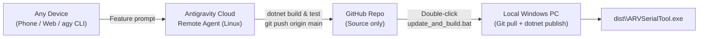

# Remote Agent Workflow — Developing ARVSerialTool from Anywhere

This guide explains how to request new **ARVSerialTool** features from any device (phone, web browser, or any laptop) using **Google Antigravity Remote Agents** + **GitHub**, and then pull & build `ARVSerialTool.exe` on your Windows machine in one click with [`update_and_build.bat`](../update_and_build.bat).



> [!NOTE]
> The GitHub repository stores **source code only** (no `.exe` files). Cloud Remote Agents run on Linux VMs, verify compilation (`EnableWindowsTargeting=true`) and Core tests (`tests/EverLogger.Tests`), and push source commits to `main`. GitHub Actions runs Windows tests on every push to `main`, and [`update_and_build.bat`](../update_and_build.bat) builds the real portable `ARVSerialTool.exe` locally on your Windows PC.

---

## Part 1: One-Time Setup

### 1A. Connect This GitHub Repository to Antigravity Remote Agents

> **Requirement:** Remote Agents require a **personal Google Account** subscribed to **Google AI Pro** or **Google AI Ultra**.

1. Open the **Antigravity** app or web workspace (`https://antigravity.google`) and sign in with your eligible Google Account.
2. Create a new **Remote Project** (for example, `ARVSerialTool`) or open an existing remote project → **Project Settings → Resources → Add Resource**.
3. Select **GitHub**, complete the OAuth sign-in, and grant access to **`congsy3004/ViLogger`**.

From now on, Antigravity clones this repository into a cloud workspace and automatically follows [`AGENTS.md`](../AGENTS.md) on every Remote Agent task.

### 1B. Prepare Any Local Windows Machine Where You Want the `.exe`

1. Install **Git for Windows** and the **.NET 8 SDK** (`https://dotnet.microsoft.com/download/dotnet/8.0`).
2. Clone the repository once:
   ```powershell
   git clone https://github.com/congsy3004/ViLogger.git ARVSerialTool
   ```
3. *(Optional)* Right-click [`update_and_build.bat`](../update_and_build.bat) → **Send to → Desktop (create shortcut)** so updating and rebuilding takes one double-click.

---

## Part 2: Adding a New Feature Until You Have the Executable

### Step 1 — Ask the Remote Agent (From Phone, Web, or Another PC)

Open **Antigravity** at `https://antigravity.google` (or run `agy --remote-agent --project "ARVSerialTool"` from any terminal), and describe what you want:

- **Feature / Bugfix Prompt Template:**
  > *"Implement `<describe feature or fix>` on `main`, add xUnit tests in `tests/EverLogger.Tests`, verify `dotnet test EverLogger.sln -c Release` passes, update `README.md` / `docs/LIMITS.md` / `HelpWindow.xaml` if needed, commit using Conventional Commits, and push `main` to `origin`."*

- **Version Bump Prompt Template (optional, when ready to mark a version):**
  > *"Implement `<describe feature>`, follow the Version Bump Checklist in `AGENTS.md` for `vX.Y.Z`, verify `dotnet test EverLogger.sln -c Release` passes, and push `main` (and tag `vX.Y.Z`) to `origin`."*

### Step 2 — Cloud Verification (Automatic)

1. The Remote Agent edits the codebase, runs `dotnet build EverLogger.sln -c Release` and `dotnet test EverLogger.sln -c Release` in the cloud, and pushes source commits directly to `origin/main`.
2. GitHub Actions (`.github/workflows/build.yml`) runs all Windows tests (Core + WPF ViewModel tests) on `windows-latest` to confirm everything compiles and passes on Windows.

### Step 3 — Pull & Build Locally in One Click

On your local Windows machine, double-click [`update_and_build.bat`](../update_and_build.bat). It automatically:

1. Checks that `git` and `dotnet` are installed, the repo is on `main`, and there are no uncommitted local edits.
2. Runs `git pull --ff-only origin main`.
3. **Skips building** if no new commits were pulled and `dist\ARVSerialTool.exe` already exists.
4. Checks that `dist\ARVSerialTool.exe` (or `publish\ARVSerialTool.exe`) is not currently open — if it is open, it warns you and remembers the pending build for the next click.
5. Runs `dotnet publish` straight to single-file self-contained `publish\ARVSerialTool.exe` and copies it to `dist\ARVSerialTool.exe` *(preserving any existing `Logs\` folder)*.
6. Displays the full path to run the executable (`<repo>\dist\ARVSerialTool.exe`) and pauses so you can read the result.

---

## Part 3: Edge Cases & Tips

- **If `ARVSerialTool.exe` is running when you double-click `update_and_build.bat`:** The script pulls the latest commits cleanly, sees the `.exe` is open, pauses with a warning, and keeps a `.build_pending` marker inside `dist\` so after you close the app and double-click `update_and_build.bat` again, it immediately runs the build even though `git pull` has nothing new.
- **Force a clean rebuild anytime:** Run `update_and_build.bat --force` from a terminal.
- **Uncommitted local changes protection:** If you edited any tracked file locally or left temporary files inside the repo, `update_and_build.bat` refuses to pull/overwrite and shows `git status -s` so you never lose work.
- **Icon changes (`tools/make_icon.ps1`):** Because icon rendering uses Windows GDI+ (`System.Drawing`), run `pwsh tools/make_icon.ps1` on a Windows PC rather than inside a Linux Remote Agent.
