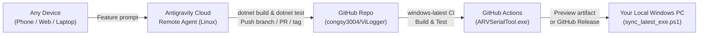

# Remote Agent Workflow — Developing ARVSerialTool from Anywhere

This guide explains how to request and ship new **ARVSerialTool** features from any device (phone, tablet, browser, or another laptop) using **Google Antigravity Remote Agents** + **GitHub Actions**, and automatically receive the built Windows `ARVSerialTool.exe` on your local Windows PC.



> [!NOTE]
> Even though Antigravity Remote Agents run in cloud Linux VMs, this repository sets `EnableWindowsTargeting=true` (`Directory.Build.props`) and OS-aware xUnit tests (`tests/EverLogger.Tests`), so the Remote Agent still compiles your WPF UI/XAML and runs Core tests before pushing. GitHub Actions (`windows-latest`) then compiles the final native Windows single-file `ARVSerialTool.exe`.

---

## Part 1: One-Time Setup

### 1A. Connect This GitHub Repository to Antigravity Remote Agents

> **Requirement:** Remote Agents require a **personal Google Account** subscribed to **Google AI Pro** or **Google AI Ultra** (Workspace/free tiers do not include cloud Remote Agents).

1. Open the **Antigravity** app or web workspace (`https://antigravity.google`) and sign in with your eligible Google Account.
2. Create a new **Remote Project** (or open an existing remote project → **Project Settings → Resources → Add Resource**).
3. Select **GitHub**, complete the OAuth sign-in, and grant access to **`congsy3004/ViLogger`**.

From now on, Antigravity will automatically clone this repository into a fresh cloud sandbox and apply the rules in [`AGENTS.md`](../AGENTS.md) whenever you launch a Remote Agent task.

---

### 1B. Prepare Your Local Windows Machine(s)

Choose whichever setup matches the machine where you want `ARVSerialTool.exe` to appear:

#### Easiest: Double-Click Setup *(No manual terminal commands needed)*
- **Inside this repo:** double-click [`tools/setup_autosync.bat`](../tools/setup_autosync.bat) once in File Explorer.
  - Registers a background Windows Scheduled Task (`ARVSerialTool-AutoSync`) checking every 15 minutes and immediately downloads/verifies `dist\ARVSerialTool.exe`.
  - Later, double-click [`tools/update_and_launch.bat`](../tools/update_and_launch.bat) anytime to check for updates and launch the app immediately.
- **On any other Windows PC (no Git or `.NET` required):** create a folder like `C:\Tools\ARVSerialTool\`, copy **only** `setup_autosync.bat` *(and optionally `update_and_launch.bat`)* into it, and double-click `setup_autosync.bat` — it automatically fetches `sync_latest_exe.ps1` on first run and downloads `ARVSerialTool.exe` alongside it *(preserving `Logs\`)*.

#### Option A: Standalone Folder via PowerShell *(Advanced / custom flags)*
1. Create a folder on that PC, e.g. `C:\Tools\ARVSerialTool\`, and copy [`tools/sync_latest_exe.ps1`](../tools/sync_latest_exe.ps1) into it.
2. Run once to download the current release right into that folder:
   ```powershell
   powershell -NoProfile -ExecutionPolicy Bypass -File .\sync_latest_exe.ps1
   ```
3. *(Optional — Hands-Free Auto-Sync)* Register the 15-minute background task:
   ```powershell
   powershell -NoProfile -ExecutionPolicy Bypass -File .\sync_latest_exe.ps1 -RegisterTask
   ```
   *(To stop automatic checks later, run `.\sync_latest_exe.ps1 -UnregisterTask`.)*

#### Option B: Your Development PC *(Inside this Git clone)*
Run from the repository root whenever you want the latest GitHub-built release in `dist\ARVSerialTool.exe`:
```powershell
powershell -NoProfile -ExecutionPolicy Bypass -File .\tools\sync_latest_exe.ps1
```
*(Your `Logs\` folder is never touched during updates.)*

---

## Part 2: Step-by-Step Workflow When Adding a New Feature

### Stage 1 — Start a Remote Agent Task (From Phone, Web, or Another PC)

Open **Antigravity** on any device (web, desktop, or double-click [`tools/start_remote_agent.bat`](../tools/start_remote_agent.bat) to launch `agy --remote-agent --project "ARVSerialTool"` in a terminal), choose your connected **Remote Project**, and send your request.

- **Pattern A — Test a Preview Build First *(Recommended for UI / Hardware changes)*:**
  > *"Create a feature branch `feat/<name>`, implement `<describe feature>`, add xUnit tests in `tests/EverLogger.Tests`, verify `dotnet test EverLogger.sln -c Release` passes, commit using Conventional Commits, and push the branch to `origin` (do not tag a release yet)."*

- **Pattern B — Implement & Release Immediately:**
  > *"Implement `<describe feature>`, update `tests/EverLogger.Tests`, `README.md`, `docs/LIMITS.md`, and `HelpWindow.xaml`, follow the Release Checklist in `AGENTS.md` to bump to `vX.Y.Z`, push `main`, and push tag `vX.Y.Z`."*

---

### Stage 2 — Cloud Verification & Automated Windows Build

1. The **Remote Agent** implements the changes, runs `dotnet build EverLogger.sln -c Release` and `dotnet test EverLogger.sln -c Release`, and pushes commits to GitHub.
2. **GitHub Actions** (`.github/workflows/build.yml`) immediately starts a **`windows-latest`** runner that:
   - Executes all Windows tests (both Core tests and WPF ViewModel tests).
   - Builds the single-file self-contained `ARVSerialTool.exe` with the embedded application icon and Win32 metadata.
   - Uploads `ARVSerialTool-win-x64` as a downloadable CI artifact (retained for 14 days).

---

### Stage 3A — Testing a Preview Build on a Local Machine *(Before Releasing)*

Once the green check appears on your branch/PR:

- **Via Browser (no tools needed on the Windows PC):**
  1. Open `https://github.com/congsy3004/ViLogger/actions`.
  2. Click the latest green **Build** run for your branch.
  3. Scroll to **Artifacts** and download **`ARVSerialTool-win-x64`**, unzip, and run `ARVSerialTool.exe` against your real COM port / device.
- **Via One Command (if [GitHub CLI (`gh`)](https://cli.github.com/) is installed & signed in):**
  ```powershell
  powershell -NoProfile -ExecutionPolicy Bypass -File .\tools\sync_latest_exe.ps1 -Branch feat/<name> -Launch
  ```

---

### Stage 3B — Shipping & Getting the Final Release `.exe` on Any Machine

When you are happy with the feature (or if you used Pattern B directly):

1. Reply to the Remote Agent from anywhere:
   > *"Merge `feat/<name>` into `main`, follow the Release Checklist in `AGENTS.md` to release `vX.Y.Z`, and push `main` + tag `vX.Y.Z`."*
2. Pushing tag `vX.Y.Z` triggers `.github/workflows/release.yml` on `windows-latest`, which runs tests, publishes `ARVSerialTool.exe` + `ARVSerialTool-vX.Y.Z-win-x64.zip`, and creates the **GitHub Release** in ~1–2 minutes.
3. Get the new `ARVSerialTool.exe` on any Windows machine using any of these 3 methods:
   - **Automatic background sync:** Wait up to 15 minutes (if `-RegisterTask` is enabled) — `ARVSerialTool.exe` updates silently while closed (if currently open, it skips safely and updates on the next check after you close the app).
   - **Manual 1-click update & launch:**
     ```powershell
     powershell -NoProfile -ExecutionPolicy Bypass -File .\sync_latest_exe.ps1 -Launch
     ```
   - **Direct download URL (always points to newest version):**
     `https://github.com/congsy3004/ViLogger/releases/latest/download/ARVSerialTool.exe`

---

## Part 3: Reference & Edge Cases

### Clickable `.bat` Launchers (`tools/`)

| File | What double-clicking does |
|---|---|
| [`tools/setup_autosync.bat`](../tools/setup_autosync.bat) | Registers the 15-minute `ARVSerialTool-AutoSync` background task and downloads the latest `ARVSerialTool.exe` (self-bootstraps `sync_latest_exe.ps1` if copied alone to another PC) |
| [`tools/update_and_launch.bat`](../tools/update_and_launch.bat) | Checks GitHub Releases, updates `ARVSerialTool.exe` if newer, and launches it immediately |
| [`tools/start_remote_agent.bat`](../tools/start_remote_agent.bat) | Opens an `agy` CLI session connected to Remote Project `ARVSerialTool` (`--remote-agent --project "ARVSerialTool"`) |

### `tools/sync_latest_exe.ps1` Parameters

| Flag | Default | Purpose |
|---|---|---|
| `-InstallDir <path>` | `dist\` (in repo) or script folder (standalone) | Folder where `ARVSerialTool.exe` is placed (never deletes `Logs\`) |
| `-Repo <owner/name>` | `congsy3004/ViLogger` | GitHub repository to query |
| `-Branch <name>` | *(empty → latest Release)* | Pull latest successful CI build artifact from `<name>` via `gh` CLI |
| `-Token <PAT>` | `$env:GITHUB_TOKEN` | GitHub token (only needed if the repository is made private) |
| `-Force` | `$false` | Re-download even if local version matches latest release |
| `-Launch` | `$false` | Start `ARVSerialTool.exe` immediately after syncing |
| `-RegisterTask` | `$false` | Create/update Windows Scheduled Task `ARVSerialTool-AutoSync` |
| `-UnregisterTask` | `$false` | Remove scheduled task `ARVSerialTool-AutoSync` |
| `-IntervalMinutes <N>` | `15` | Poll interval in minutes when used with `-RegisterTask` (`1–1439`) |

### Important Notes
- **If the app is open when syncing:** `sync_latest_exe.ps1` detects the running `ARVSerialTool.exe` process locks that path, leaves your active serial/log session untouched, and lets you update cleanly after closing the app.
- **If you want to regenerate icons (`tools/make_icon.ps1`):** Because icon rendering uses Windows GDI+ (`System.Drawing`), run `pwsh tools/make_icon.ps1` on a Windows PC (or via **Remote Control** on your Windows PC) rather than inside a Linux Remote Agent.
- **If the repository becomes private later:** Set `$env:GITHUB_TOKEN` (a read-only fine-grained PAT with *Contents: Read*) or authenticate `gh auth login`, and `sync_latest_exe.ps1` will work identically.
